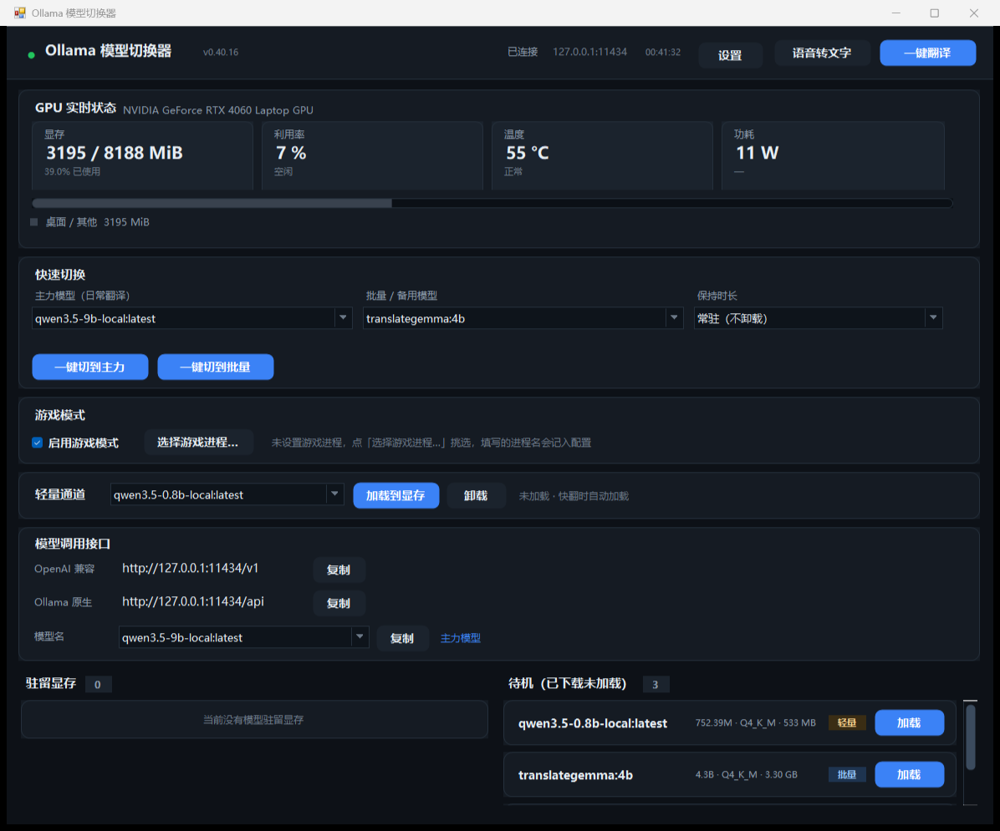
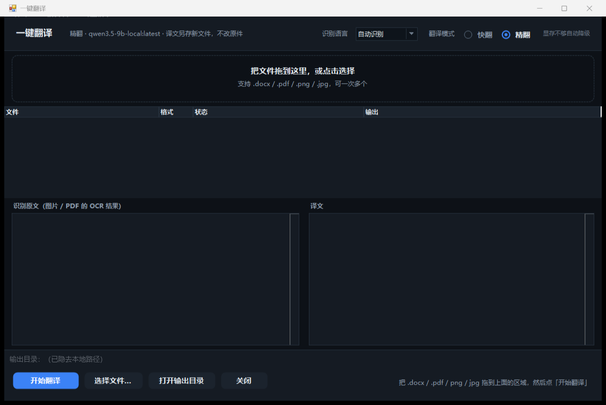

# Ollama Model Switcher

Windows 上的本地 Ollama 模型切换器，附带文档翻译与语音转写。全部处理都在本机完成，不上传任何文件。

单文件 WinForms（.NET Framework 4.8），中文深色界面，双击即用。

## 功能

- **模型切换**：管理主力 / 批量 / 轻量三个模型角色，一键切换并重启 Ollama 服务，显示显存与运行状态
- **文档翻译**：`.docx` 直接改写段落；`.pdf` / 图片先渲染再 OCR，逐页对照翻译；长文件分段落盘，可随时停止并保留已译部分
- **语音转文字**：内置 faster-whisper 引擎，拖入音频即可转写，支持导出




## 目录结构

```
src/
  Core.cs            Ollama 服务探测、模型列表、配置读写、HTTP 调用
  MainForm.cs        主窗口 + 全局 UI 主题（控件工厂、配色、字号）
  TranslateForm.cs   翻译窗口
  SpeechForm.cs      语音转文字窗口
  DocTranslate.cs    文档解析（docx / pdf / 图片）、OCR、分段翻译与断点落盘
work/
  build.ps1          正式构建（嵌入资源，输出单 exe）
  build_shot.ps1     构建 UI 截图工具
  build_test.ps1     构建 PDF 翻译命令行测试工具
  build_probe.ps1    构建 OCR 单页测试工具
  UiShot.cs          截图工具源码
  TestPdf.cs         PDF 翻译测试工具源码
  OcrProbe.cs        OCR 测试工具源码
  asr/asr_transcribe.py   faster-whisper 转写脚本（PyInstaller 打成 asr_engine.exe）
  pyi/asr_engine.spec     PyInstaller 打包配置
  mkpdf.py / dumptxt.py / pedeps.py   开发辅助脚本
docs/
  用法说明.md        完整使用说明
  images/            界面截图
```

## 构建

需要 Windows 10/11 + .NET Framework 4.8（系统自带 `csc.exe`，不需要 Visual Studio）。

```powershell
cd work
powershell -ExecutionPolicy Bypass -File build.ps1 ..\dist\Ollama-Model-Switcher.exe `
    "asr_engine=..\work\pyi\dist\asr_engine.exe" `
    "model.bin=D:\models\faster-whisper-small\model.bin" `
    "config.json=D:\models\faster-whisper-small\config.json" `
    "ocr.zip=..\work\ocr.zip"
```

资源说明（仓库不含这些二进制，需要自行准备）：

| 资源 | 来源 |
| --- | --- |
| `asr_engine.exe` | `pyinstaller work/pyi/asr_engine.spec`，依赖 `faster-whisper`、`ctranslate2` |
| `model.bin` / `config.json` | faster-whisper-small 模型（HuggingFace / ModelScope 下载） |
| `ocr.zip` | Tesseract 5.x + `tessdata_fast` 的 `rus/eng/osd`，结构见下 |

`ocr.zip` 内部结构：

```
tesseract.exe
*.dll                 同目录的 Tesseract 运行时依赖
tessdata/rus.traineddata
tessdata/eng.traineddata
tessdata/osd.traineddata
```

程序首次使用时会把这个包解压到 `%TEMP%\OllamaModelSwitcher\` 并复用。

> 只用 `src` 里的代码时，直接编译 `src/*.cs` 即可得到界面程序，只是缺少内嵌资源时翻译/转写不可用。

## 运行前提

- 本机已安装并运行 Ollama（默认 `127.0.0.1:11434`），也可由程序按配置路径启动
- 默认模型名是 `qwen3.5-9b-local:latest` / `translategemma:4b` / `qwen3.5-0.8b-local:latest`，在界面的下拉框里换成自己已下载的模型即可
- 语音转写与 OCR 的语言数据均随 exe 内嵌，不依赖系统语言包

## 隐私

翻译与转写全部调用本机 Ollama / 本地引擎，文档不会离开本机。仓库源码中不含任何密钥、账号或本机绝对路径。

## 说明

仓库只包含源代码与少量截图，不包含 exe、模型权重、Tesseract 语言数据和历史测试产物。

## 许可证

MIT，见 [LICENSE](LICENSE)。
